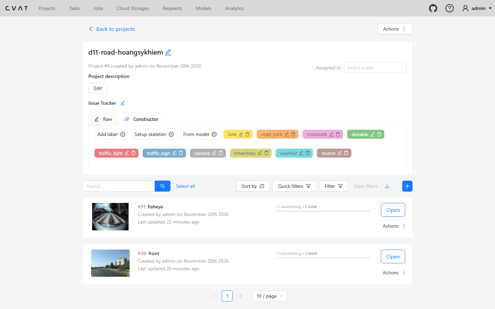
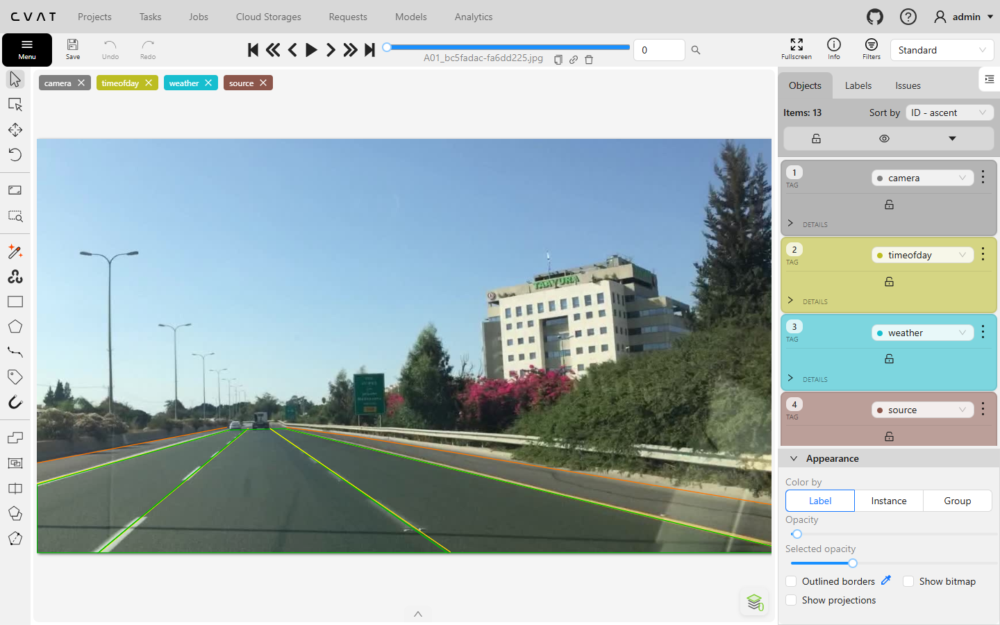
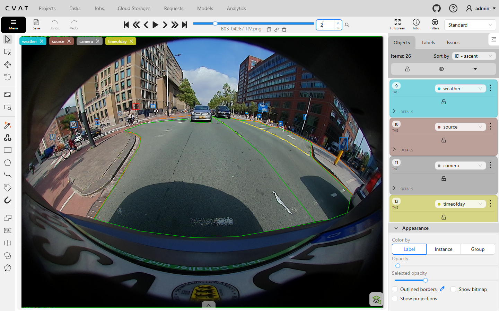
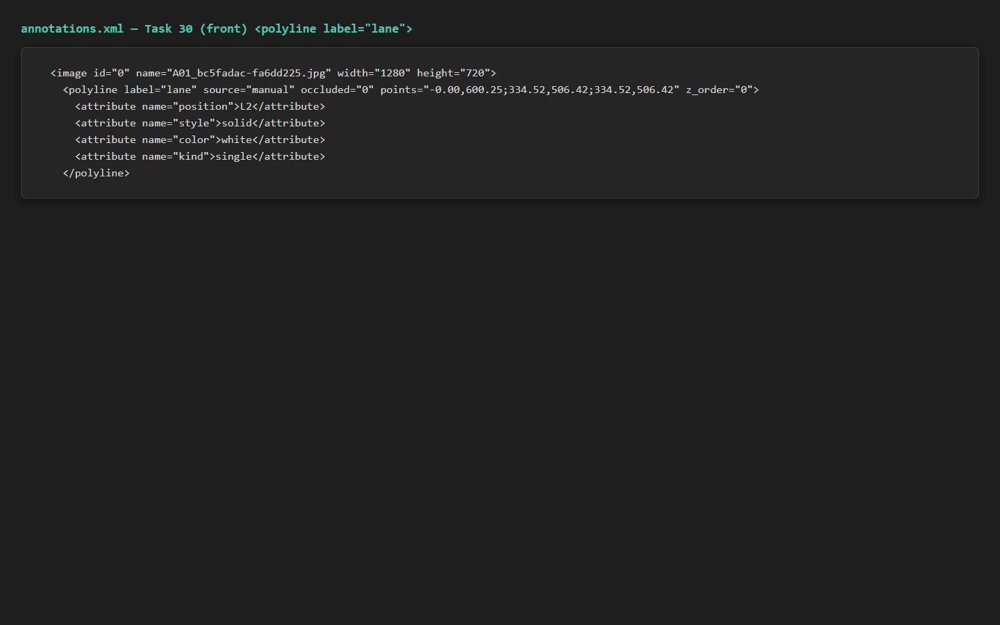

# Báo cáo cá nhân — Ngày 11
Họ tên: Hoàng Sỹ Khiêm              Mã học viên: 2A202603244  
Phiên bản CVAT (Help → About): v2.82.0  
Guideline: Road v1.0    Lần nộp (`revision` trong manifest): 1  
Thời điểm export (ngày giờ trên CVAT): 21/11/2026 08:44    Số lần nộp lại sau Rework: 0  

## 1. Kiểm project
| Mục | Đúng như guideline Road v1.0? | Ghi chú |
| --- | --- | --- |
| 6 label, đúng kiểu | Đúng | lane, road_curb, crosswalk, drivable, traffic_light, traffic_sign |
| Thuộc tính và giá trị | Đúng | Khớp hoàn toàn với configs/road_v1_labels.json |
| 4 tag ảnh | Đúng | camera, timeofday, weather, source |
Cách kết thúc polyline trên bản CVAT này: Nhấn phím N (hoặc click đúp tại điểm cuối)  
Cách đặt tag ảnh trên bản CVAT này: Chọn công cụ Tag ở thanh bên trái, chọn label tag tương ứng và kiểm tra thuộc tính value trong bảng Details  

## 2. Số lượng đã gán
| Task | Ảnh | lane | road_curb | crosswalk | drivable | traffic_light | traffic_sign |
| --- | ---: | ---: | ---: | ---: | ---: | ---: | ---: |
| front | 12 | 30 | 20 | 6 | 25 | 43 | 72 |
| front-extra (đã làm 4 / 4) | 4 | 13 | 7 | 4 | 8 | 14 | 23 |
| fisheye | 8 | 7 | 21 | 12 | 16 | 7 | 17 |
| fisheye-extra (đã làm 4 / 4) | 4 | 6 | 4 | 5 | 8 | 0 | 1 |

## 3. Bảng ca khó
| Ảnh | Nhãn | Phân vân giữa | Đã chọn | Lý do |
| --- | --- | --- | --- | --- |
| A13 | weather (tag) | clear vs rain | rain | Bầu trời nhìn sáng nhưng kính lái bị mờ đục do vệt nước ẩm sau mưa làm giảm tầm nhìn, theo chuẩn BDD100K xếp vào ca trời mưa |
| A16 | timeofday (tag) | day vs dusk | day | Nhà cao tầng che khuất bầu trời, nhưng đèn xe và đèn đường chưa bật, ánh sáng khuếch tán vẫn sáng rõ đặc trưng ban ngày |
| A05, A06 | lane | vẽ thêm vạch vs không vẽ | không vẽ | Đường không có vạch sơn kẻ mép (chỉ có lề đường/bãi xe), tuân thủ nghiêm ngặt quy tắc "không vẽ vạch mà ảnh không có" (được miễn theo Checkpoint mục 6) |
| B06 | drivable | bỏ qua vs alternative | alternative | Làn sơn đỏ cho xe đạp nhưng vạch biên là vạch trắng đứt (advisory bike lane), ô tô được phép đi vào khi đường trống theo luật |
| B11 | lane | gán ô đỗ xe vs bỏ qua | bỏ qua | Nhận diện đây là ô đỗ xe người khuyết tật (bẫy QC1-03), chỉ vẽ vạch phân làn dọc đường xe chạy, bỏ qua toàn bộ vạch ô đỗ xe |

## 4. Phiếu QC 1 nhận được
Bạn kiểm lô của tôi:               Quyết định nhận được:  
| Mã lỗi | Số lỗi | Đồng ý? | Đã sửa? |
| --- | ---: | --- | --- |

## 5. Kiểm file export
| File | Mở lại được? | Số shape ảnh 1 (job / file) | Số shape ảnh 2 (job / file) | Tag camera có trong XML? |
| --- | --- | --- | --- | --- |
| hoangsykhiem-front.zip | Có (pass lint) | A01: 9 / 9 | A02: 8 / 8 | Có (camera=front) |
| hoangsykhiem-fisheye.zip | Có (pass lint) | B01: 5 / 5 | B02: 7 / 7 | Có (camera=fisheye_front) |

## 6. Ảnh chụp màn hình
1. Tab Labels của project:  
   
2. Một ảnh camera trước đã gán đủ (làn, vùng lái, đèn/biển - A01):  
   
3. Một ảnh fisheye đã gán, phóng to đoạn polyline cong (B03):  
   
4. Một đoạn XML có `<polyline label="lane">`:  
   

## 7. Tự đánh giá
Lỗi bạn mắc nhiều nhất hôm nay (theo mã QC1-xx), và cách tránh ở Ngày 20:  
- Lỗi vẽ polyline fisheye chưa đủ số điểm uốn cong theo vòng thấu kính mắt cá (QC1-11) và quy ước position=other ở camera sườn (QC1-03). Cách tránh: Luôn đặt tối thiểu 4 điểm bám sát cung đường tròn và kiểm tra kỹ hướng camera trước khi gán thuộc tính.
Nhãn của bạn đi vào model ở đâu? Chọn một lỗi đã sửa và nói nó làm model học sai thế nào:  
- Lỗi gán sai vạch ô đỗ xe thành vạch làn (QC1-03): Khiến model nhận diện nhầm ô đỗ xe là làn đường lưu thông, dẫn tới hệ thống điều khiển tự động (Lane Keeping Assist) có thể bẻ lái xe đâm vào hàng xe đang đỗ bên lề đường.

## 8. (Tùy chọn, buffer) Từ polyline đến đích row-anchor
| y | 720 | 680 | 640 | 600 | 560 |
| --- | ---: | ---: | ---: | ---: | ---: |
| x của chúng tôi |  |  |  |  |  |
| x của bạn kia |  |  |  |  |  |

Trả lời 3 câu:

1. Năm số x đó chính là đích mà một model row-anchor học cho vạch này. Nếu bạn dừng polyline sớm 40 px, hàng nào đổi thành "không có làn"?
   - Hàng y=560 sẽ đổi thành "không có làn" (out-of-bounds/no lane) do polyline dừng trước khi chạm tới độ cao dòng này.
2. So với bạn được kiểm (cùng ảnh): ở hàng 720 và hàng 560, hai bạn lệch nhau bao nhiêu pixel? Lệch ở hàng nào ảnh hưởng LKA nhiều hơn (slide 25)?
   - Lệch ở hàng gần xe (y=720) ảnh hưởng nghiêm trọng hơn đến LKA vì đây là điểm định vị tức thời của xe trong làn, sai lệch lớn sẽ gây giật lái nguy hiểm.
3. Nếu polyline vẽ từ xa về gần (ngược quy tắc 2), cách tính trên có đổi không? Script nào sẽ gặp khó?
   - Cách nội suy tọa độ x theo hàng y không đổi, nhưng script tính toán hướng vectơ và kiểm tra tính đơn điệu (như road_check) sẽ báo lỗi ngược chiều (QC1-04).
